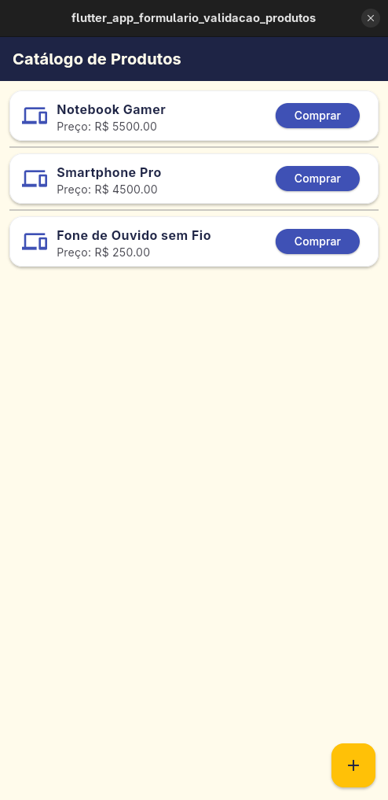
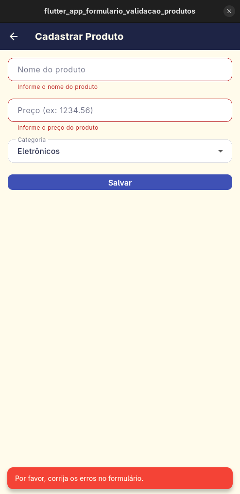
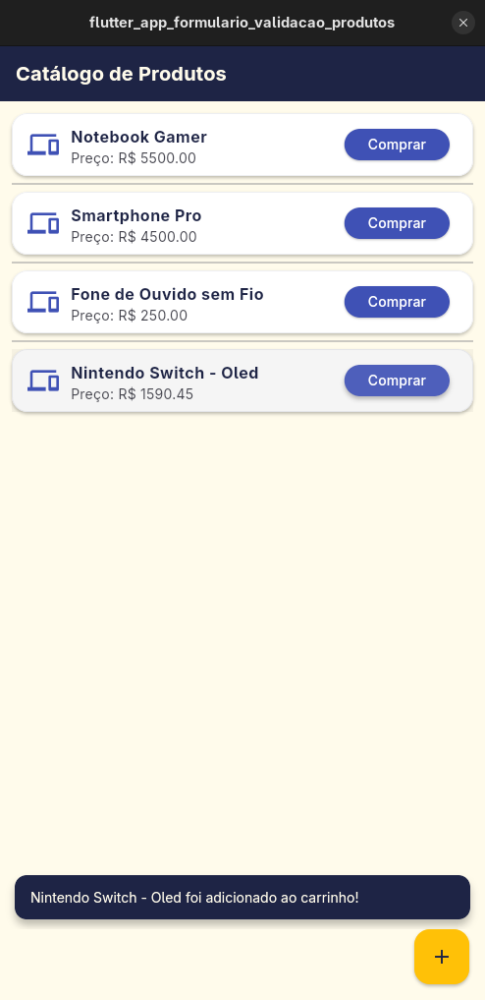
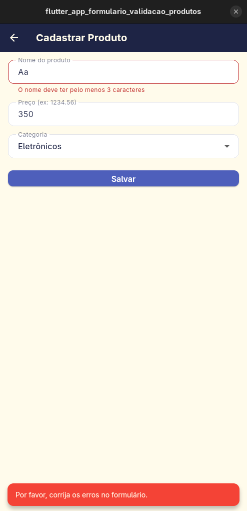
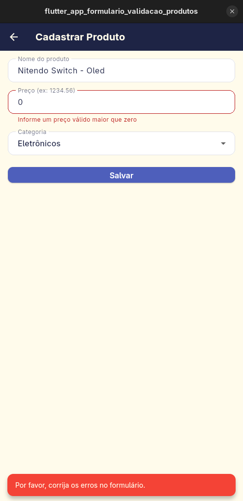

# Catálogo de Produtos

Aplicativo Flutter desenvolvido para a atividade **Atividade 06 – Formulário e Validação**. O projeto permite visualizar uma lista de produtos, acessar a tela de cadastro, validar os dados informados e atualizar o catálogo dinamicamente, sem perder os itens já cadastrados.

# Catálogo de Produtos

Aplicativo Flutter desenvolvido para a atividade **Atividade 06 – Formulário e Validação**. O projeto permite visualizar uma lista de produtos, acessar a tela de cadastro, validar os dados informados e atualizar o catálogo dinamicamente, sem perder os itens já cadastrados.

## Imagens do aplicativo

<p align="center">
  
  
  
</p>
<p align="center">
  
  
</p>

## Objetivo da atividade

Continuando o desenvolvimento do aplicativo **Catálogo de Produtos**, a aplicação deve permitir:

- visualizar uma lista de produtos na tela principal;
- navegar para a tela de cadastro ao pressionar o botão de adicionar;
- preencher nome, preço e categoria do novo produto;
- validar os campos antes do cadastro;
- retornar para a lista principal e incluir o novo item sem sobrescrever os existentes;
- exibir o ícone correto de acordo com a categoria;
- mostrar um `SnackBar` ao adicionar um produto ao carrinho.

## Funcionalidades implementadas

- **Catálogo de produtos** em `ListView` com cards para cada item;
- **Botão de adicionar** que direciona para a tela **Cadastrar Produto**;
- **Formulário de cadastro** com `Form`, `TextFormField` e `DropdownButton`;
- **Validação de campos** com mensagens de erro quando os dados não atendem às regras;
- **Retorno à tela principal** com o novo produto adicionado ao final da lista;
- **Ícone dinâmico** baseado na categoria do produto;
- **SnackBar** informando que o produto foi adicionado ao carrinho;
- **Tema visual consistente** com as cores e estilo já definidos no projeto.

## Regras de validação

Os campos do formulário são validados conforme as regras abaixo:

1. **Nome do produto**
   - não pode ficar vazio;
   - deve conter pelo menos 3 caracteres.

2. **Preço**
   - não pode ficar vazio;
   - deve ser um valor numérico válido;
   - deve ser maior que zero.

3. **Categoria**
   - deve ser selecionada por meio de um `DropdownButton`;
   - caso não seja escolhida, a validação deve informar ao usuário.

## Categorias e ícones

| Categoria    | Ícone                          |
| ------------ | ------------------------------ |
| Eletrônicos  | `Icons.devices`                |
| Vestuário    | `Icons.checkroom`              |
| Livros       | `Icons.book`                   |
| Relógio      | `Icons.watch`                  |
| Sacola       | `Icons.shopping_bag`           |

O ícone é definido pela categoria no modelo `Product`, em `lib/models/product.dart`.

## Estrutura do projeto

```text
lib/
├── main.dart                                  # MaterialApp e inicialização do app
├── models/
│   └── product.dart                           # Modelo Product + ícone por categoria
├── screens/
│   ├── add_product/
│   │   └── add_product_screen.dart            # Formulário de cadastro + validações
│   └── product_list/
│       └── product_list_screen.dart           # Lista de produtos + SnackBar + FAB
├── theme/
│   └── app_theme.dart                         # Tema visual do aplicativo
└──
```

## Requisitos da atividade 06

| Requisito | Descrição |
| --------- | --------- |
| 1 | Ao pressionar o botão de adicionar, o usuário é direcionado para a tela **Cadastrar Produto**. |
| 2 | Na tela de cadastro, são informados: nome, preço e categoria selecionada em `DropdownButton`. |
| 3 | O formulário usa `Form` para validar os campos e apresenta mensagens de erro quando alguma regra não é atendida. |
| 4 | Após a validação, o aplicativo retorna à tela principal e inclui o novo produto na lista, sem substituir os itens existentes. |
| 5 | O ícone do catálogo é definido de acordo com a categoria escolhida para o produto. |
| 6 | Ao clicar em um produto, o app exibe um `SnackBar` informando que o produto foi adicionado ao carrinho. |

## Observações

O projeto foi estruturado para manter o tema já configurado no app, preservando a identidade visual e adicionando o fluxo de cadastro e validação exigido pela atividade.


## Objetivo da atividade

Continuando o desenvolvimento do aplicativo **Catálogo de Produtos**, a aplicação deve permitir:

- visualizar uma lista de produtos na tela principal;
- navegar para a tela de cadastro ao pressionar o botão de adicionar;
- preencher nome, preço e categoria do novo produto;
- validar os campos antes do cadastro;
- retornar para a lista principal e incluir o novo item sem sobrescrever os existentes;
- exibir o ícone correto de acordo com a categoria;
- mostrar um `SnackBar` ao adicionar um produto ao carrinho.

## Funcionalidades implementadas

- **Catálogo de produtos** em `ListView` com cards para cada item;
- **Botão de adicionar** que direciona para a tela **Cadastrar Produto**;
- **Formulário de cadastro** com `Form`, `TextFormField` e `DropdownButton`;
- **Validação de campos** com mensagens de erro quando os dados não atendem às regras;
- **Retorno à tela principal** com o novo produto adicionado ao final da lista;
- **Ícone dinâmico** baseado na categoria do produto;
- **SnackBar** informando que o produto foi adicionado ao carrinho;
- **Tema visual consistente** com as cores e estilo já definidos no projeto.

## Regras de validação

Os campos do formulário são validados conforme as regras abaixo:

1. **Nome do produto**
   - não pode ficar vazio;
   - deve conter pelo menos 3 caracteres.

2. **Preço**
   - não pode ficar vazio;
   - deve ser um valor numérico válido;
   - deve ser maior que zero.

3. **Categoria**
   - deve ser selecionada por meio de um `DropdownButton`;
   - caso não seja escolhida, a validação deve informar ao usuário.

## Categorias e ícones

| Categoria    | Ícone                          |
| ------------ | ------------------------------ |
| Eletrônicos  | `Icons.devices`                |
| Vestuário    | `Icons.checkroom`              |
| Livros       | `Icons.book`                   |
| Relógio      | `Icons.watch`                  |
| Sacola       | `Icons.shopping_bag`           |

O ícone é definido pela categoria no modelo `Product`, em `lib/models/product.dart`.

## Estrutura do projeto

```text
lib/
├── main.dart                                  # MaterialApp e inicialização do app
├── models/
│   └── product.dart                           # Modelo Product + ícone por categoria
├── screens/
│   ├── add_product/
│   │   └── add_product_screen.dart            # Formulário de cadastro + validações
│   └── product_list/
│       └── product_list_screen.dart           # Lista de produtos + SnackBar + FAB
├── theme/
│   └── app_theme.dart                         # Tema visual do aplicativo
└──
```

## Requisitos da atividade 06

| Requisito | Descrição |
| --------- | --------- |
| 1 | Ao pressionar o botão de adicionar, o usuário é direcionado para a tela **Cadastrar Produto**. |
| 2 | Na tela de cadastro, são informados: nome, preço e categoria selecionada em `DropdownButton`. |
| 3 | O formulário usa `Form` para validar os campos e apresenta mensagens de erro quando alguma regra não é atendida. |
| 4 | Após a validação, o aplicativo retorna à tela principal e inclui o novo produto na lista, sem substituir os itens existentes. |
| 5 | O ícone do catálogo é definido de acordo com a categoria escolhida para o produto. |
| 6 | Ao clicar em um produto, o app exibe um `SnackBar` informando que o produto foi adicionado ao carrinho. |

## Observações

O projeto foi estruturado para manter o tema já configurado no app, preservando a identidade visual e adicionando o fluxo de cadastro e validação exigido pela atividade.
